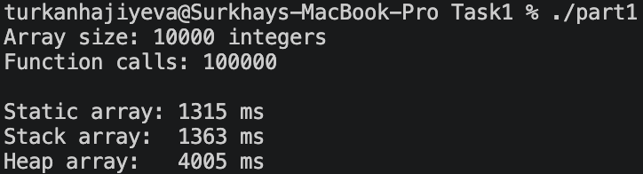

# Part 1: C++ Memory Allocation Performance Comparison

## What we do?

We create three C++ functions that declare or allocate a large array using different memory allocation methods:

- **Static:**
- **Stack:**
- **Heap**

For this task `timeTimeCalc` function runs each function 100000 times, and the total execution time is measured using the C++ <chrono> library.

```c++
double TimeCalc(Function func) {
    
    // Record starting time
    auto start =
        high_resolution_clock::now();

    for (int i = 0; i < CALLS; i++) {
        func(i);
    }

    // Record ending time
    auto stop =
        high_resolution_clock::now();

    auto duration =
        duration_cast<milliseconds>(stop - start).count();

    return duration;
}
```

As seen from code sample time is measured for full run of all 100000 calls and returned in milliseconds

The purpose is to understand how memory allocation strategies affect program performance.



From the output it is seen that static and stack are almost similar while heap requires much more time than the rest.

The reason for it is how each memmory allocation straategy works, so lets go over them 1 by 1

## Static Allocation

Static allocation used to allocate all the data objects at compile time. 

In our code we force array to use static allocation using `static` keyword 
```c++
void staticArray(int n) {
    static int arr[N];
    long long sum = 0;
    for (int i = 0; i < N; i++) {
        arr[i] = i + n;
        sum += arr[i];
    }
    result = sum;
}
```
In static allocation, the compiler decides the extent of storage which cannot be changed with time, hence it is easy for the compiler to know the addresses at a later stage, therefore it has a large benefir of not needing to allocate or release the array on every invocation.

In simplistic terms no matter how many times you go into a function call the variable is referring to the same memory location, and which dont free after they not needed anymore.

## Stack Allocation

Stack allocation is used to allocate all the data objects at runtime time as a local variable. 

```c++
void stackArray(int n) {
    int arr[N];
    long long sum = 0;
    for (int i = 0; i < N; i++) {
        arr[i] = i + n;
        sum += arr[i];
    }
    result = sum;
}
```

In simplistic terms stack variables are useful for when you know that as long as the function is used, you will want the variables to remain. Stacks are nice for variables that you need for the code where they are located, but which isn't needed outside that code, so after execution in all needed places its storage is automatically reclaimed when the function returns.

## Heap Allocation

Heap allocation is used to allocate all the data objects at runtime time. 


```c++
void heapArray(int n) {
    unique_ptr<int[]> arr(new int[N]);
    long long sum = 0;
    for (int i = 0; i < N; i++) {
        arr[i] = i + n;
        sum += arr[i];
    }
    result = sum;
}
```

Heap is useful when you want to be more flexible than the above. Frequently, a function gets called to respond to an event, and you dont want to pollute your code with unneeded memmory and thats where its useful. It allocates memmory only when it is called and thats why it takes more time than others since it needs to reestablish itself 100000 times what takes unneeded memmory allocation time

