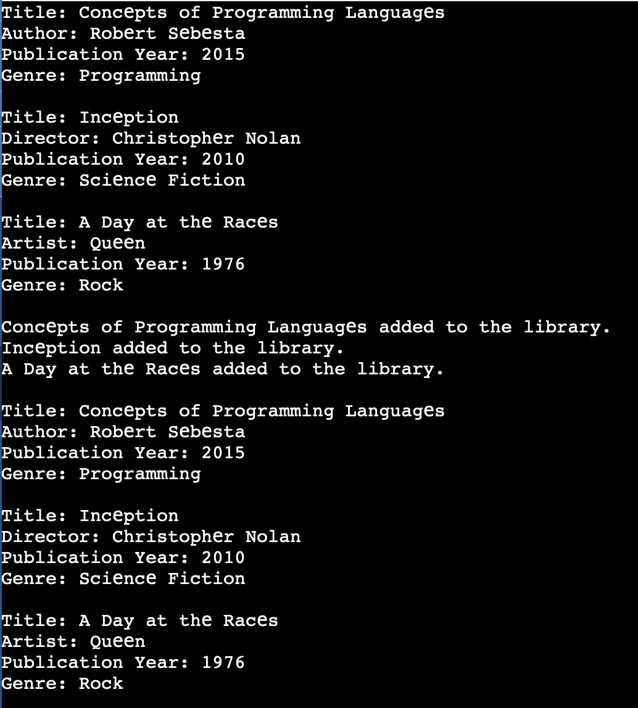

# Part 3: Library Catalog System in Ruby

## What we do?

We create a Ruby library catalog system to demonstrate the main object-oriented programming principles:

- **Class design**
- **Inheritance**
- **Encapsulation**
- **Polymorphism**

The system manages three types of library items:

- **Books**
- **DVDs**
- **CDs**

Every item has common properties such as a title, an author or creator, and a publication year. Each derived class also has a property specific to its type.



The output shows the details of each item when it is displayed individually
and again after all items are added to the library.

## Base Class: LibraryItem

The `LibraryItem` class contains the properties and behavior shared by all library items:

```ruby
class LibraryItem
  attr_reader :title, :author, :publication_year

  def initialize(title, author, publication_year)
    @title = title
    @author = author
    @publication_year = publication_year
  end

  def display_info
    puts "Title: #{@title}"
    puts "Author: #{@author}"
    puts "Publication Year: #{@publication_year}"
  end
end
```

The `attr_reader` declarations provide read-only access to the common properties. The `initialize` method sets the values when an item is created.

## Derived Classes

`Book`, `DVD`, and `CD` inherit from `LibraryItem`. They reuse the common properties and add information specific to each type.

### Book

A book has an additional `genre` property. Its `display_info` method calls the base implementation with `super` and then displays the genre:

```ruby
class Book < LibraryItem
  attr_reader :genre

  def initialize(title, author, publication_year, genre)
    super(title, author, publication_year)
    @genre = genre
  end

  def display_info
    super
    puts "Genre: #{@genre}"
  end
end
```

### DVD

A DVD stores a `director` and a `genre`. The director is passed to the base class as the creator of the item:

```ruby
class DVD < LibraryItem
  attr_reader :director, :genre

  def initialize(title, director, publication_year, genre)
    super(title, director, publication_year)
    @director = director
    @genre = genre
  end
end
```

### CD

A CD stores an `artist` and a `genre`:

```ruby
class CD < LibraryItem
  attr_reader :artist, :genre

  def initialize(title, artist, publication_year, genre)
    super(title, artist, publication_year)
    @artist = artist
    @genre = genre
  end
end
```

Each derived class defines its own `display_info` method, so it can print both the common details and the type-specific details.

## Encapsulation

Encapsulation is implemented by storing values in instance variables such as `@title`, `@author`, and `@genre`. These variables are accessed through `attr_reader`, which allows values to be read without exposing direct modification methods.

The internal collection of items is also encapsulated inside the `Library` class using the `@items` instance variable.

## Library Class

The `Library` class stores and manages a collection of different library items:

```ruby
class Library
  def initialize
    @items = []
  end

  def add_item(item)
    @items << item
    puts "#{item.title} added to the library."
  end

  def remove_item(item)
    if @items.delete(item)
      puts "#{item.title} removed from the library."
    else
      puts "Item not found in the library."
    end
  end
end
```

The class provides methods for:

- Adding an item with `add_item`
- Removing an item with `remove_item`
- Displaying all items with `display_all_items`

## Polymorphism

The `display_all_items` method demonstrates polymorphism:

```ruby
def display_all_items
  if @items.empty?
    puts "The library is empty."
    return
  end

  @items.each do |item|
    item.display_info
  end
end
```

The `@items` array contains `Book`, `DVD`, and `CD` objects. The same `item.display_info` call is used for every object, but Ruby executes the appropriate implementation according to the item's actual type.